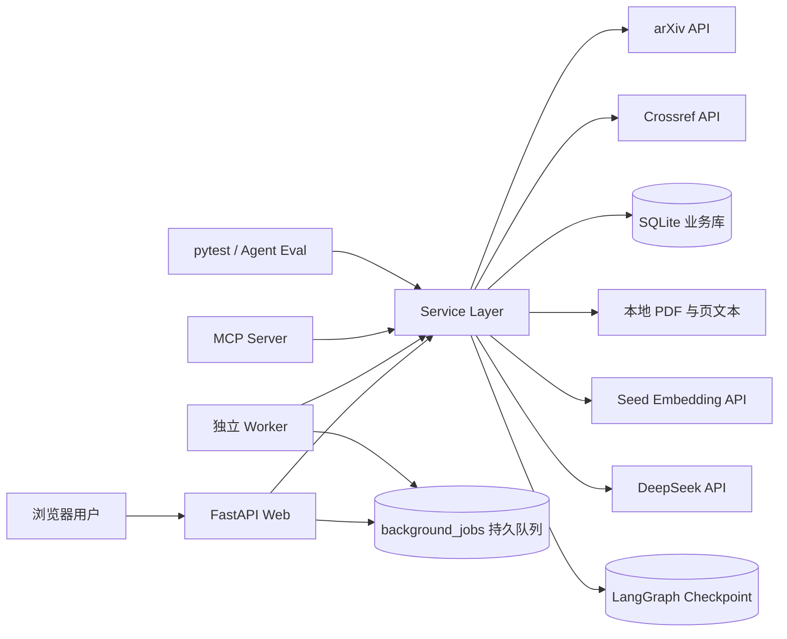
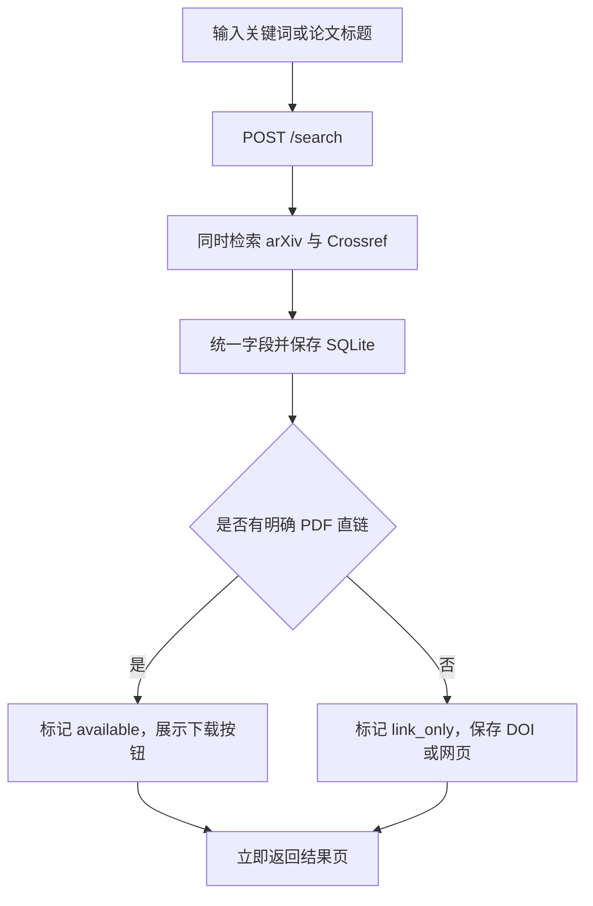
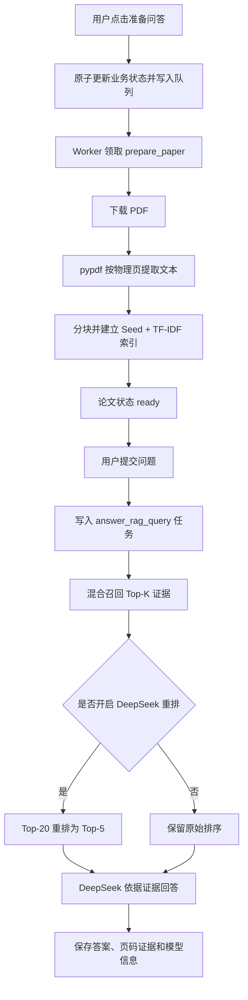
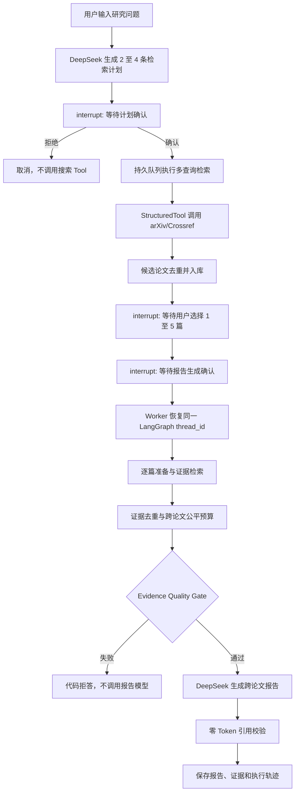
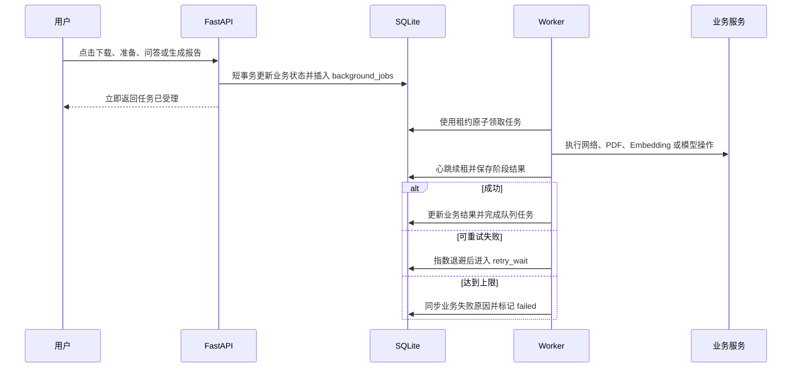

# Paper Hunter 项目全景说明

> 项目版本：`v0.13.1`
>
> 文档更新日期：`2026-08-20`
>
> 项目定位：可演示、可评测、可恢复的论文检索与研究 Agent

这份文档用于快速回答三个问题：Paper Hunter 能做什么、使用了哪些技术、一次用户请求在系统中如何流转。详细使用方法见 [README.md](README.md)，版本变化见 [CHANGELOG.md](CHANGELOG.md)，实验记录见 [EXPERIMENTS.md](EXPERIMENTS.md)，后续路线见 [ROADMAP.md](ROADMAP.md)。

## 一句话介绍

Paper Hunter 是一个基于 FastAPI、LangGraph、DeepSeek 和混合检索的论文研究助手。它可以从 arXiv 与 Crossref 搜索论文，在用户授权后下载开放获取 PDF，完成解析、索引和带页码证据的问答，也可以通过带人工审批的 Agent 工作流生成跨论文研究报告。

## 用户可以完成什么

| 使用场景 | 用户操作 | 系统结果 |
| --- | --- | --- |
| 普通检索 | 输入关键词或论文标题 | 返回 arXiv、Crossref 论文元数据并保存来源链接 |
| 合法下载 | 点击明确可下载论文的下载按钮 | Worker 下载 PDF，记录状态、路径和下载日期 |
| 单篇问答 | 点击准备问答并输入问题 | 下载、解析、索引后，依据论文原文给出带页码证据的回答 |
| 智能研究 | 输入研究问题并选择智能研究模式 | Agent 规划查询、等待确认、检索候选论文并等待用户选择 |
| 跨论文报告 | 选择 1 至 5 篇论文并确认生成 | 整理多篇证据，在质量门禁通过后生成带引用报告 |
| 历史与导出 | 查看历史、详情或导出 | 查看任务进度、错误、论文链接，并导出 CSV/JSON |
| 开发评测 | 运行检索或 Agent 评测 | 输出 Hit@K、MRR、覆盖率、场景通过率和运行指标 |

## 系统架构



系统按职责分为五层：

| 层级 | 主要模块 | 职责 |
| --- | --- | --- |
| 展示与接口层 | `main.py`、`templates/`、`static/` | 接收请求、渲染页面、提供状态 API，不执行长任务 |
| Agent 编排层 | `research_agent.py`、`research_workflow.py`、`research_checkpoint.py` | 规划任务、条件路由、人工确认、中断与恢复 |
| 业务服务层 | `search_service.py`、`download_service.py`、`pdf_service.py`、`rag_service.py` | 搜索、下载、解析、分块、索引、召回与问答 |
| 可靠任务层 | `task_queue_service.py`、`worker.py`、`paper_workflow.py` | 持久入队、租约领取、心跳、重试、幂等与断点执行 |
| 数据与评测层 | `db.py`、`evaluation_service.py`、`agent_*_service.py` | 持久化、缓存、检索评测、Trace、Metrics 与报告 |

## 技术栈总览

| 分类 | 技术 | 在项目中的用途 |
| --- | --- | --- |
| 编程语言 | Python 3.11+ | 后端、Agent、数据处理和测试 |
| Web 后端 | FastAPI、Uvicorn | 页面路由、表单请求、状态 API 和导出接口 |
| 页面渲染 | Jinja2、HTML、CSS、JavaScript | 服务端页面、状态轮询和交互 |
| HTTP 客户端 | httpx、requests | 调用论文来源、DeepSeek 和 Seed API |
| 数据库 | SQLite | 论文、任务、证据、报告、缓存、Trace 和评测记录 |
| 任务系统 | 自研 SQLite 持久队列、独立 Worker | 长任务持久化、租约抢占、心跳、重试和恢复 |
| Agent 编排 | LangGraph | 状态图、条件分支、`interrupt()` 人工审批和恢复 |
| Agent 状态 | `SqliteSaver` | 使用稳定 `thread_id` 保存 LangGraph Checkpoint |
| Tool Calling | LangChain `StructuredTool`、白名单 Registry | 结构化参数校验、受控工具调用和调用审计 |
| 大语言模型 | DeepSeek Chat API | 查询规划、可选重排、单篇回答和跨论文报告 |
| Embedding | 火山方舟 Seed1.6 Embedding | 中英文语义向量和论文片段召回 |
| 本地检索 | TF-IDF、余弦相似度、RRF | 关键词召回、无 API 降级和多路排名融合 |
| PDF 处理 | pypdf | 提取物理页文本、保留页码、建立证据块 |
| 上下文工程 | 证据去重、公平预算、质量门禁、引用校验 | 控制 Token、降低无证据生成和引用错误 |
| 协议扩展 | MCP Python SDK | 对外提供受控的元数据、检索和证据 Tool |
| 测试评测 | pytest、mock、JUnit XML | 离线测试、故障场景验证和 Agent 评测报告 |
| 工程工具 | uv、Git、GitHub | 依赖管理、可复现运行和版本管理 |

## 核心流程一：普通论文检索



检索阶段只处理元数据，不自动下载。arXiv 可以生成规范 PDF 地址；Crossref 没有明确 `.pdf` 绝对直链时保守降级为 `link_only`，避免错误跳转和版权风险。

## 核心流程二：单篇论文问答



没有本地全文时，系统不会假装读过论文，而是提示可能需要购买或机构订阅并提供合法访问链接。Seed 不可用时可以降级为本地 TF-IDF；DeepSeek 不可用时只影响生成能力，不影响基础检索与归档。

## 核心流程三：智能研究 Agent



这里使用 Agent 的原因不是为了聊天，而是任务存在动态规划、工具调用、人工决策、逐篇容错和可恢复状态。论文选择、下载授权和报告生成都保留人工边界。

## 核心流程四：可靠后台任务



队列采用单机 SQLite 的至少一次执行语义。系统依靠去重键、条件更新、阶段检查和结果幂等避免重复副作用，不宣称分布式 Worker 或严格恰好一次。

## 数据如何保存

| 数据类型 | 主要表或位置 | 说明 |
| --- | --- | --- |
| 论文元数据 | `papers` | 标题、作者、来源、出版商、DOI、URL、状态和本地路径 |
| 任务队列 | `background_jobs` | 任务类型、载荷、状态、重试次数、租约和错误 |
| PDF 解析 | `paper_documents`、`paper_chunks` | 文档状态、页码文本块、向量和父子关系 |
| RAG 问答 | `rag_queries` | 问题、回答、证据、模型、重排配置和错误 |
| 研究 Agent | `research_tasks`、`research_tool_calls`、`research_reports` | 计划、工具轨迹、选择结果和跨论文报告 |
| Agent 可观测性 | `agent_traces` | 节点状态、耗时、工具调用、重试和错误 |
| 缓存 | `pdf_text_cache`、`embedding_cache`、`llm_response_cache` | 避免重复解析、Embedding 和受控实验调用 |
| 检索与生成评测 | `evaluation_*`、`generation_evaluation_*` | 配置、逐题结果、聚合指标和实验历史 |
| 运行文件 | `downloads/` | PDF、SQLite 数据库与导出文件，默认不提交 Git |

LangGraph Checkpoint 与业务数据库职责不同：Checkpoint 保存图执行到了哪里，业务表保存用户能看到的论文、任务、证据和报告。二者通过 `thread_id` 和 `task_id` 关联。

## 可靠性、安全与合规设计

- **用户授权**：PDF 下载必须由用户点击触发，搜索完成后不自动下载。
- **原子入队**：业务状态变化和队列任务创建在同一短事务中完成，避免“状态变了但任务没创建”。
- **并发去重**：条件更新与活动任务去重防止双击产生重复下载、索引或报告。
- **失败隔离**：单篇论文或单个搜索源失败不会无条件拖垮整个任务。
- **任务恢复**：Worker 中断后，租约过期任务可以重新领取；LangGraph 使用 Checkpoint 恢复图状态。
- **有限重试**：默认最多尝试 3 次，使用指数退避，不无限循环。
- **证据门禁**：没有合法证据时不调用报告模型，降低幻觉和无效 Token 消耗。
- **引用检查**：报告生成后用确定性规则校验论文标题和物理页码，不再调用第二个大模型。
- **版权边界**：Crossref 非 PDF 链接只归档；不接入 Sci-Hub、登录站点或绕过付费墙的能力。
- **密钥保护**：API Key 只从 `.env` 读取；`.env`、数据库和下载 PDF 均由 Git 忽略。
- **文件安全**：清洗非法文件名、限制长度、处理重名，并统一 UTF-8 输出。

## 降本增效设计

| 设计 | 节省的资源或时间 |
| --- | --- |
| PDF 页文本哈希缓存 | 切换分块策略时不重复解析 PDF |
| Embedding 命名空间与文本哈希缓存 | 相同模型和文本不重复请求 Seed |
| LLM 响应缓存 | 受控实验中避免重复调用相同模型请求 |
| 文档索引复用 | 只修改 Top-K 或融合权重时直接重新排名 |
| Evidence Quality Gate | 无证据或上下文不合法时不调用 DeepSeek |
| 跨论文公平 Token 预算 | 限制上下文总量，同时避免某一篇论文占满预算 |
| 确定性去重和引用检查 | 不额外增加模型调用 |
| 可选 DeepSeek 重排 | 默认关闭，用户按质量需求决定是否增加成本 |
| Worker 断点与幂等 | 重启后跳过已完成阶段，减少重复下载、解析和生成 |

## 当前可复现成果

- 使用 28 篇论文、140 道带物理页码证据的人工问题，建立开发集和两套冻结独立集。
- 默认链路为固定边界 `1200/150`、Seed 语义向量和 TF-IDF 混合召回。
- DeepSeek 可选重排在一套 8 篇、40 题独立集上将 `Hit@3` 从 `67.50%` 提高到 `90.00%`，MRR 从 `0.6204` 提高到 `0.7675`。
- M1 多粒度父子融合在开发集提高前三名召回，但独立集主指标下降，因此只保留为实验策略，没有为了结果好看替换默认链路。
- Agent 可靠性评测冻结 11 条场景，离线报告结果为 `11/11 passed`。
- B1 队列专项测试 `42 passed`，完整离线测试 `199 passed`，外部服务全部使用 mock。

这些数字证明的是受控数据和离线故障场景下的工程行为，不等同于公网 SLA、真实用户量或大规模行业基准。

## 主要代码入口

| 想了解的内容 | 建议先读 |
| --- | --- |
| Web 路由与请求入口 | `my_agent_project/main.py` |
| SQLite 表与原子入队 | `my_agent_project/db.py` |
| Worker 如何执行与重试 | `my_agent_project/task_queue_service.py`、`worker.py` |
| 搜索 arXiv/Crossref | `my_agent_project/search_service.py` |
| PDF 解析与分块 | `my_agent_project/pdf_service.py` |
| Embedding、检索与问答 | `my_agent_project/rag_service.py`、`model_service.py` |
| LangGraph 工作流 | `my_agent_project/research_agent.py`、`research_workflow.py` |
| 上下文与报告质量 | `my_agent_project/context_service.py`、`research_report_service.py` |
| Trace 与 Agent Metrics | `my_agent_project/agent_trace_service.py`、`agent_metrics_service.py` |
| MCP Tool | `my_agent_project/mcp_server.py` |
| 自动化测试 | `tests/` |

## 本地运行

终端一启动 Web：

```powershell
uv run uvicorn my_agent_project.main:app --host 127.0.0.1 --port 8001
```

终端二启动 Worker：

```powershell
uv run python -m my_agent_project.worker
```

浏览器访问：

```text
http://127.0.0.1:8001/
```

运行离线测试：

```powershell
uv run pytest
```

## 当前完成度与必要后续

### 已经完成

- 本地可运行的完整产品闭环。
- 论文检索、合法下载、RAG 问答和跨论文研究报告。
- LangGraph 人工审批、Checkpoint 恢复和受控 Tool Calling。
- 持久队列、独立 Worker、重试、租约、幂等和错误状态。
- 检索实验、生成评测、Agent Trace、Metrics 和 MCP Server。

### 还没有完成

- Docker 化的 Web + Worker 一键部署。
- 公网环境的 HTTPS、域名、登录鉴权、限流和安全策略。
- 面向并发部署的 PostgreSQL/MySQL 与对象存储。
- 生产日志采集、告警和持续监控。
- 多实例 Worker 和分布式任务队列。

因此，当前项目已经适合简历展示和本地演示，但不能描述成已经承载真实公网用户的生产系统。下一阶段最有价值的是完成 Docker 化部署闭环，而不是继续增加更多 Agent 概念。
