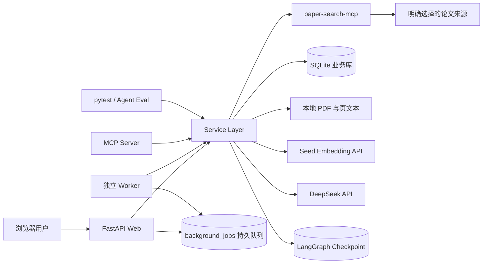
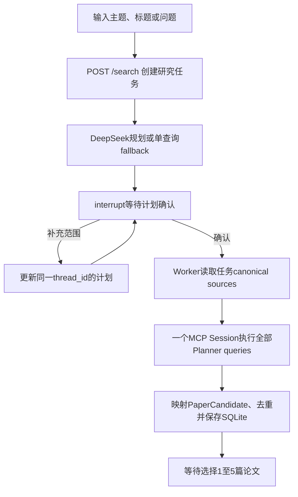
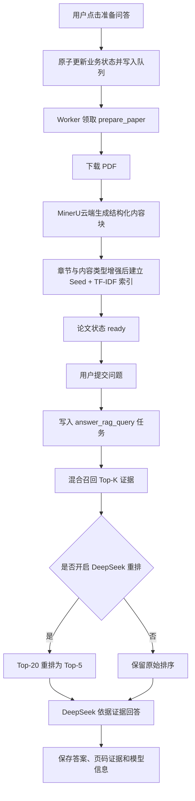
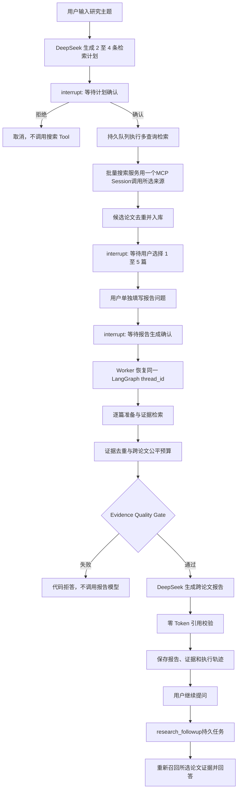
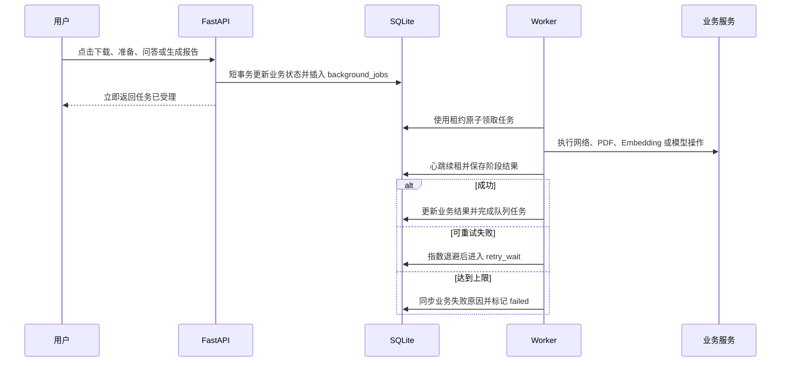

# Paper Hunter 项目全景说明

> 项目版本：`v0.15.0`
>
> 文档更新日期：`2026-08-24`
>
> 项目定位：可演示、可评测、可恢复的论文检索与研究 Agent

这份文档用于快速回答三个问题：Paper Hunter 能做什么、使用了哪些技术、一次用户请求在系统中如何流转。详细使用方法见 [README.md](README.md)，版本变化见 [CHANGELOG.md](CHANGELOG.md)，实验记录见 [EXPERIMENTS.md](EXPERIMENTS.md)，后续路线见 [ROADMAP.md](ROADMAP.md)。

## 一句话介绍

Paper Hunter 是一个基于 FastAPI、LangGraph、DeepSeek 和混合检索的论文研究助手。它通过统一论文搜索MCP检索元数据，首页允许从后端白名单提供的21个来源中多选并默认全部选中；在用户授权后下载开放获取 PDF，完成解析、索引和带页码证据的问答，也可以通过带人工审批的 Agent 工作流生成跨论文研究报告。

## 用户可以完成什么

| 使用场景 | 用户操作 | 系统结果 |
| --- | --- | --- |
| 研究发现 | 输入主题、关键词或论文标题 | 创建可调整计划，确认后通过统一MCP返回任务所选来源的候选论文 |
| 合法下载 | 点击明确可下载论文的下载按钮 | Worker 下载 PDF，记录状态、路径和下载日期 |
| 单篇问答 | 点击准备问答并输入问题 | 下载、解析、索引后，依据论文原文给出带页码证据的回答 |
| 计划协作 | 在同一任务中补充研究范围 | 重新生成计划并更新原LangGraph检查点 |
| 跨论文报告 | 选择 1 至 5 篇论文并明确报告问题 | 整理多篇证据，在质量门禁通过后生成带引用报告 |
| 报告后追问 | 在报告完成后继续提问 | 重新召回所选论文证据并异步生成带引用回答 |
| 历史与导出 | 查看历史、详情或导出 | 查看任务进度、错误、论文链接，并导出 CSV/JSON |
| 开发评测 | 运行检索或 Agent 评测 | 输出 Hit@K、MRR、覆盖率、场景通过率和运行指标 |

## 系统架构



系统按职责分为五层：

| 层级 | 主要模块 | 职责 |
| --- | --- | --- |
| 展示与接口层 | `main.py`、`templates/`、`static/` | 接收请求、渲染页面、提供状态 API，不执行长任务 |
| Agent 编排层 | `research_agent.py`、`research_workflow.py`、`research_checkpoint.py` | 规划任务、条件路由、人工确认、中断与恢复 |
| 业务服务层 | `search_service.py`、`download_service.py`、`mineru_service.py`、`pdf_service.py`、`rag_service.py`、`research_conversation_service.py` | 搜索、下载、云端解析、结构化分块、索引、召回、问答与报告后追问 |
| 可靠任务层 | `task_queue_service.py`、`worker.py`、`paper_workflow.py` | 持久入队、租约领取、心跳、重试、幂等与断点执行 |
| 数据与评测层 | `db.py`、`evaluation_service.py`、`agent_*_service.py` | 持久化、缓存、检索评测、Trace、Metrics 与报告 |

## 技术栈总览

| 分类 | 技术 | 在项目中的用途 |
| --- | --- | --- |
| 编程语言 | Python 3.11+ | 后端、Agent、数据处理和测试 |
| Web 后端 | FastAPI、Uvicorn | 页面路由、表单请求、状态 API 和导出接口 |
| 页面渲染 | Jinja2、HTML、CSS、JavaScript | 服务端页面、状态轮询和交互 |
| HTTP 客户端 | httpx、requests | 下载开放PDF，并调用MinerU、DeepSeek和Seed API |
| 数据库 | SQLite | 论文、任务、证据、报告、缓存、Trace 和评测记录 |
| 任务系统 | 自研 SQLite 持久队列、独立 Worker | 长任务持久化、租约抢占、心跳、重试和恢复 |
| Agent 编排 | LangGraph | 状态图、条件分支、`interrupt()` 人工审批和恢复 |
| Agent 状态 | `SqliteSaver` | 使用稳定 `thread_id` 保存 LangGraph Checkpoint |
| Tool Calling | LangChain `StructuredTool`、白名单 Registry | 结构化参数校验、受控工具调用和调用审计 |
| 大语言模型 | DeepSeek Chat API | 查询规划、可选重排、单篇回答和跨论文报告 |
| Embedding | 火山方舟 Seed1.6 Embedding | 中英文语义向量和论文片段召回 |
| 本地检索 | TF-IDF、余弦相似度、RRF | 关键词召回、无 API 降级和多路排名融合 |
| PDF 处理 | MinerU 云端精准解析 API | 生产环境提取章节、表格、公式、列表、物理页码和版面坐标 |
| PDF 实验基线 | pypdf | 只用于冻结分块实验和历史结果复现，不作为生产降级 |
| 上下文工程 | 证据去重、公平预算、质量门禁、引用校验 | 控制 Token、降低无证据生成和引用错误 |
| 协议扩展 | MCP Python SDK | 对外提供受控的元数据、检索和证据 Tool |
| 测试评测 | pytest、mock、JUnit XML | 离线测试、故障场景验证和 Agent 评测报告 |
| 工程工具 | uv、Git、GitHub | 依赖管理、可复现运行和版本管理 |

## 核心流程一：统一研究发现



发现阶段只处理元数据，不自动下载。`GET /`用后端`SEARCH_SOURCE_OPTIONS`渲染来源复选框，前端不维护来源ID；新任务默认选择全部21个来源，0个来源时浏览器和`POST /search`都会拒绝提交。`research_tasks.sources_json`保存任务创建时的明确来源列表，LangGraph Checkpoint只携带执行副本；Worker恢复时以业务表为准校准State。多条Planner queries在同一个stdio MCP Session内顺序调用`search_papers`，每条query保留独立Tool Trace。升级前旧任务仍回退arXiv与Crossref。

第三方`paper-search-mcp==0.1.4`通过MCP SDK返回`structuredContent.result` envelope；Adapter负责解包并校验其中的论文、实际来源、来源数量、错误和总数，再隔离映射为`PaperCandidate`。真实复验确认同一任务的4条query只建立一个Session，并能进入现有去重与Paper Selection；MCP下载Tool不在该调用链中。

## 核心流程二：单篇论文问答



没有本地全文时，系统不会假装读过论文，而是提示可能需要购买或机构订阅并提供合法访问链接。Seed 不可用时可以降级为本地 TF-IDF；DeepSeek 不可用时只影响生成能力，不影响基础检索与归档。

## 核心流程三：研究报告与持续追问



这里使用 Agent 的原因不是单纯增加聊天框，而是任务存在动态规划、工具调用、人工决策、逐篇容错和可恢复状态。论文选择、下载授权和报告生成都保留人工边界。当前持续追问只使用当前问题、当前报告和新召回证据，完整历史压缩与长期记忆尚未实现。

## 核心流程四：可靠后台任务



队列采用单机 SQLite 的至少一次执行语义。系统依靠去重键、条件更新、阶段检查和结果幂等避免重复副作用，不宣称分布式 Worker 或严格恰好一次。

## 状态机一览

项目没有用一个万能 `status` 表示所有进度，而是让不同对象维护自己的状态机。

### 论文下载状态

```text
available
  -> downloading
  -> downloaded
  -> failed -> downloading（用户重试）

link_only（只有网页或 DOI，不进入下载流程）
```

### 文档处理状态

```text
解析：not_started -> parsing -> parsed / parse_failed
索引：not_indexed -> indexing -> indexed / index_failed
问答：answering -> answered / answer_failed
```

### 后台队列状态

```text
queued -> running -> completed
                  -> retry_wait -> running
                  -> failed
```

`background_jobs` 表示 Worker 是否成功执行任务，`papers`、`paper_documents` 和 `research_reports` 表示用户业务进行到了哪一步。入队时，两者在同一个短事务中创建；执行期间分别更新，因为网络请求、文件写入和模型调用不能被 SQLite 事务回滚，也不能让数据库写锁一直占用几分钟。

### 研究任务状态

```text
awaiting_confirmation
  -> running
  -> awaiting_selection
  -> papers_selected
  -> completed / failed

任一人工确认阶段都可以进入 cancelled
```

研究报告另有 `not_started -> preparing -> retrieving -> generating -> completed / failed`，这样搜索候选论文和生成报告可以分别恢复、分别展示错误。

## 主要页面与接口

| 分组 | 接口 | 作用 |
| --- | --- | --- |
| 首页 | `GET /` | 展示统一研究工作台入口 |
| 搜索 | `POST /search` | 创建研究任务、初始消息与可确认计划 |
| 论文历史 | `GET /papers` | 查看论文、下载、解析和索引状态 |
| 论文详情 | `GET /papers/{paper_id}` | 查看元数据、合法链接、处理进度、证据与问答 |
| 论文处理 | `POST /papers/{paper_id}/download` | 用户触发 PDF 持久下载任务 |
| 论文处理 | `POST /papers/{paper_id}/prepare` | 按下载、解析、索引顺序准备问答 |
| 单步调试 | `POST /papers/{paper_id}/parse` | 单独提交 PDF 解析任务 |
| 单步调试 | `POST /papers/{paper_id}/index` | 单独提交索引任务 |
| 单篇 RAG | `POST /papers/{paper_id}/ask` | 提交持久问答任务 |
| 研究任务 | `GET /research-tasks/{task_id}` | 查看计划、候选论文、报告和队列进度 |
| 人工审批 | `POST /research-tasks/{task_id}/confirm` | 批准检索计划后才允许调用搜索 Tool |
| 人工审批 | `POST /research-tasks/{task_id}/select` | 从本任务候选中冻结 1 至 5 篇论文 |
| 研究会话 | `POST /research-tasks/{task_id}/message` | 调整计划、设置报告问题或提交报告后追问 |
| 研究报告 | `POST /research-tasks/{task_id}/report` | 恢复同一 LangGraph 线程并持久生成报告 |
| 运行状态 | `GET /api/papers/statuses` | 页面轻量轮询论文和任务状态 |
| Agent Trace | `GET /api/research-tasks/{task_id}/traces` | 查看节点执行轨迹 |
| Agent Metrics | `GET /api/agent/metrics` | 查看有明确统计口径的运行指标 |
| 检索评测 | `GET /evaluation` | 配置并比较分块、召回和重排实验 |
| 生成评测 | `GET /generation-evaluation` | 评估回答忠实性、相关性和引用正确性 |
| 数据导出 | `GET /export.csv`、`GET /export.json` | 导出论文检索记录 |

页面路由负责请求校验、提交任务和展示状态。下载、解析、索引、单篇问答、研究检索和研究报告都由独立 Worker 执行，不在 Web 请求中等待长任务完成。

研究任务页固定加载轻量轮询脚本；脚本仅在搜索、报告或追问运行时每2秒请求状态API。客户端使用`cache: "no-store"`，接口返回`Cache-Control: no-store`。进入完成/失败终态时，页面自动重载并展示完整结果。

## 数据如何保存

| 数据类型 | 主要表或位置 | 说明 |
| --- | --- | --- |
| 论文元数据 | `papers` | 标题、作者、来源、出版商、DOI、URL、状态和本地路径 |
| 任务队列 | `background_jobs` | 任务类型、载荷、状态、重试次数、租约和错误 |
| PDF 解析 | `paper_documents`、`paper_chunks` | 文档状态、页码文本块、向量和父子关系 |
| RAG 问答 | `rag_queries` | 问题、回答、证据、模型、重排配置和错误 |
| 研究 Agent | `research_tasks`、`research_messages`、`research_tool_calls`、`research_reports` | canonical来源列表、计划、任务内消息、工具轨迹、选择结果和跨论文报告 |
| Agent 可观测性 | `agent_traces` | 节点状态、耗时、工具调用、重试和错误 |
| 缓存 | `pdf_text_cache`、`embedding_cache`、`llm_response_cache` | 避免重复解析、Embedding 和受控实验调用 |
| 检索与生成评测 | `evaluation_*`、`generation_evaluation_*` | 配置、逐题结果、聚合指标和实验历史 |
| 运行文件 | `downloads/` | PDF、SQLite 数据库与导出文件，默认不提交 Git |

LangGraph Checkpoint 与业务数据库职责不同：Checkpoint 保存图执行到了哪里及本次执行使用的`sources`副本，业务表保存canonical来源配置以及用户能看到的论文、任务、证据和报告。二者通过 `thread_id` 和 `task_id` 关联，恢复时以业务表来源为准。

## 可靠性、安全与合规设计

- **用户授权**：PDF 下载必须由用户点击触发，搜索完成后不自动下载。
- **原子入队**：业务状态变化和队列任务创建在同一短事务中完成，避免“状态变了但任务没创建”。
- **并发去重**：条件更新与活动任务去重防止双击产生重复下载、索引或报告。
- **失败隔离**：单篇论文或单个搜索源失败不会无条件拖垮整个任务。
- **任务恢复**：Worker 中断后，租约过期任务可以重新领取；LangGraph 使用 Checkpoint 恢复图状态。
- **有限重试**：默认最多尝试 3 次，使用指数退避，不无限循环。
- **证据门禁**：没有合法证据时不调用报告模型，降低幻觉和无效 Token 消耗。
- **引用检查**：报告生成后用确定性规则校验论文标题和物理页码，不再调用第二个大模型。
- **版权边界**：Crossref 非 PDF 链接只归档；不接入 Sci-Hub、登录站点或绕过付费墙的能力。
- **密钥保护**：API Key 只从 `.env` 读取；`.env`、数据库和下载 PDF 均由 Git 忽略。
- **文件安全**：清洗非法文件名、限制长度、处理重名，并统一 UTF-8 输出。

## 关键架构决策

| 决策 | 为什么这样做 | 没有这样做会怎样 |
| --- | --- | --- |
| 搜索与下载分开 | 用户应先看到结果并明确授权下载 | 请求容易超时，也可能未经用户确认下载文件 |
| Web 与 Worker 分开 | Web 只受理请求，长任务可重试、可恢复 | Web 重启会丢失进程内任务，页面请求长期占用 |
| 业务状态与队列状态分开 | 两者描述不同对象，但入队时保持原子一致 | 一个状态字段无法表达“业务到解析阶段，但任务正在重试” |
| SQLite 事务保持短小 | 避免长时间写锁，外部副作用本来也无法回滚 | PDF 下载或模型调用期间会阻塞其他写请求 |
| 至少一次执行加幂等 | Worker 崩溃后允许任务重新领取，同时避免重复副作用 | 只追求不重复会导致任务丢失，只追求重试会重复调用模型 |
| LangGraph Checkpoint 独立保存 | 图位置和业务结果生命周期、查询方式不同 | 很难区分“节点执行位置”与“用户能看到的结果” |
| Tool 白名单 | 当前业务步骤明确，模型不应自由调用任意函数 | 非法工具可能产生不可控副作用，也增加 Token 和延迟 |
| 三个人工审批点 | 查询计划、论文范围和报告生成都属于关键决策 | Agent 可能扩大检索范围、自动下载或消耗不必要模型费用 |
| 无证据时代码拒答 | 确定性约束比让模型自我检查更便宜可靠 | 模型可能在没有全文时编造论文结论 |
| DeepSeek 重排设为可选 | 重排能提升质量，但增加模型调用、成本和延迟 | 全量强制调用会让简单问题也承担高成本 |
| 生产默认MinerU结构块，固定边界保留为实验基线 | 产品需要表格、公式和章节结构，历史结论仍需可复现 | 静默混用两套解析器会让知识库行为不可预测 |

这些决策共同体现了项目的工程目标：关键选择由用户控制，长任务可靠执行，模型只在确实需要语义判断或内容生成时调用。

## 降本增效设计

| 设计 | 节省的资源或时间 |
| --- | --- |
| MinerU 结果哈希缓存 | 相同 PDF 与模型不重复上传和解析 |
| PDF 页文本哈希缓存 | 受控分块实验切换策略时不重复运行 pypdf |
| Embedding 命名空间与文本哈希缓存 | 相同模型和文本不重复请求 Seed |
| LLM 响应缓存 | 受控实验中避免重复调用相同模型请求 |
| 文档索引复用 | 只修改 Top-K 或融合权重时直接重新排名 |
| Evidence Quality Gate | 无证据或上下文不合法时不调用 DeepSeek |
| 跨论文公平 Token 预算 | 限制上下文总量，同时避免某一篇论文占满预算 |
| 确定性去重和引用检查 | 不额外增加模型调用 |
| 可选 DeepSeek 重排 | 默认关闭，用户按质量需求决定是否增加成本 |
| Worker 断点与幂等 | 重启后跳过已完成阶段，减少重复下载、解析和生成 |

## 当前可复现成果

- 使用 28 篇论文、140 道带物理页码证据的人工问题，建立开发集和两套冻结独立集。
- 当前生产链路为 MinerU 结构化块、章节/内容类型索引前缀、Seed 语义向量和 TF-IDF 混合召回；固定边界 `1200/150` 仍是冻结实验基线。
- DeepSeek 可选重排在一套 8 篇、40 题独立集上将 `Hit@3` 从 `67.50%` 提高到 `90.00%`，MRR 从 `0.6204` 提高到 `0.7675`。
- M1 多粒度父子融合在开发集提高前三名召回，但独立集主指标下降，因此只保留为实验策略，没有为了结果好看替换默认链路。
- Agent 可靠性评测冻结 11 条场景，离线报告结果为 `11/11 passed`。
- B1 队列专项测试 `42 passed`，完整离线测试 `199 passed`，外部服务全部使用 mock。

这些数字证明的是受控数据和离线故障场景下的工程行为，不等同于公网 SLA、真实用户量或大规模行业基准。

## 面试时如何概括

可以按下面四步介绍，不需要一开始罗列所有文件：

1. **业务问题**：普通论文网站只能返回链接，用户还要自己下载、整理和逐篇阅读；Paper Hunter 把合法检索、全文准备、证据问答和跨论文研究连接成一个闭环。
2. **Agent 必要性**：普通单篇问答使用固定 RAG 工作流；只有跨论文研究存在动态查询规划、工具调用、候选选择和逐篇容错，因此使用 LangGraph，并保留三个人工审批点。
3. **工程难点**：PDF 下载、解析、Embedding 和报告生成耗时较长，所以设计 SQLite 持久队列与独立 Worker，用原子入队、租约、心跳、重试、幂等和 Checkpoint 解决并发与恢复问题。
4. **效果验证**：使用 28 篇论文、140 道人工证据题评测检索策略；独立集验证 DeepSeek 重排提升 Hit@3 和 MRR，同时对未通过主指标的自定义分块策略保持诚实，不把实验候选设为默认。

一句简历式总结：

> 基于 FastAPI、LangGraph、DeepSeek 和 Seed Embedding 构建论文研究 Agent；设计带人工审批的多阶段研究工作流，并通过 SQLite 持久队列、独立 Worker、租约重试、幂等恢复、证据门禁和 Agent Trace 提升长任务可靠性与结果可审计性。

## 主要代码入口

| 想了解的内容 | 建议先读 |
| --- | --- |
| Web 路由与请求入口 | `my_agent_project/main.py` |
| SQLite 表与原子入队 | `my_agent_project/db.py` |
| Worker 如何执行与重试 | `my_agent_project/task_queue_service.py`、`worker.py` |
| 搜索 arXiv/Crossref | `my_agent_project/search_service.py` |
| MinerU云端协议与结构块 | `my_agent_project/mineru_service.py` |
| 生产/实验解析路由 | `my_agent_project/pdf_service.py` |
| Embedding、检索与问答 | `my_agent_project/rag_service.py`、`model_service.py` |
| LangGraph 工作流 | `my_agent_project/research_agent.py`、`research_workflow.py` |
| 上下文与报告质量 | `my_agent_project/context_service.py`、`research_report_service.py` |
| Trace 与 Agent Metrics | `my_agent_project/agent_trace_service.py`、`agent_metrics_service.py` |
| MCP Tool | `my_agent_project/mcp_server.py` |
| 自动化测试 | `tests/` |

## 本地运行

终端一启动 Web：

```powershell
uv run uvicorn my_agent_project.main:app --host 127.0.0.1 --port 8001
```

终端二启动 Worker：

```powershell
uv run python -m my_agent_project.worker
```

浏览器访问：

```text
http://127.0.0.1:8001/
```

运行离线测试：

```powershell
uv run pytest
```

## 当前完成度与必要后续

### 已经完成

- 本地可运行的完整产品闭环。
- 论文检索、合法下载、RAG 问答和跨论文研究报告。
- LangGraph 人工审批、Checkpoint 恢复和受控 Tool Calling。
- 持久队列、独立 Worker、重试、租约、幂等和错误状态。
- 检索实验、生成评测、Agent Trace、Metrics 和 MCP Server。

### 还没有完成

- Docker 化的 Web + Worker 一键部署。
- 公网环境的 HTTPS、域名、登录鉴权、限流和安全策略。
- 面向并发部署的 PostgreSQL/MySQL 与对象存储。
- 生产日志采集、告警和持续监控。
- 多实例 Worker 和分布式任务队列。

因此，当前项目已经适合简历展示和本地演示，但不能描述成已经承载真实公网用户的生产系统。下一阶段最有价值的是完成 Docker 化部署闭环，而不是继续增加更多 Agent 概念。
