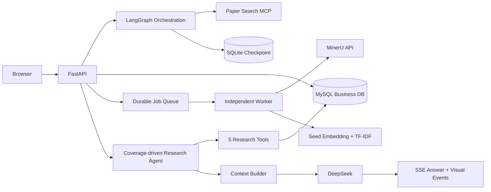

# Paper Hunter

面向学术论文的检索、解析与证据驱动问答系统。用户可以检索论文、准备 PDF，并通过 Research Agent 基于论文原文完成多轮研究；回答保留章节、页码、Chunk 与视觉区域等可追溯信息。

> 当前版本：`v0.18.0`
>
> 技术栈：Python 3.11 · FastAPI · LangGraph · DeepSeek · MCP · MinerU · MySQL · RAG

## 项目解决什么问题

普通大模型回答论文问题时，容易遇到三个问题：英文论文与中文问题的表达不一致；只命中一个短片段时上下文不完整；模型可能在证据不足时继续生成。

Paper Hunter 将论文发现、结构化解析、分层检索、Agent 研究循环和带引用回答串成一条完整链路：

```text
论文检索 → 用户选择 → PDF 下载与 MinerU 解析 → Child / Parent Chunk 入库
        → Research Agent 选择工具 → 累积原文证据 → 覆盖度检查
        → 上下文分配 → DeepSeek 回答 → 页码 / 章节 / 视觉证据展示
```

## 核心亮点

### 1. Coverage-driven Research Agent

Agent 先把用户问题整理为若干回答要求，每次工具返回后重新判断各要求是已支持、部分支持、缺失还是当前不可获得，再根据证据缺口选择下一步动作。

系统通过 DeepSeek 原生 Function Calling 暴露五类只读研究工具：

| 工具 | 适用场景 |
| --- | --- |
| `gather_evidence` | 答案位置未知时进行通用证据检索 |
| `list_sections` | 查看论文已解析并持久化的真实章节结构 |
| `read_section` | 已知完整章节路径时精确读取原文 |
| `find_in_paper` | 已知术语、参数或短语时确定性定位 |
| `inspect_tables_figures` | 已锁定视觉 Chunk 时从原 PDF 裁取表格或图片 |

Python 负责工具白名单、参数校验、Evidence ID 校验、重复调用拦截、连续无进展重规划、最多 8 次动作和 90 秒运行时保护。研究阶段明确区分 `COMPLETED`、`EXHAUSTED` 与 `FAILED`，达到安全上限时仍保留已有证据和未解决问题进入最终回答。

### 2. 跨语言多阶段 RAG

中文问题保留给语义检索，同时生成面向英文论文词面检索的英文 Query；英文 Query 只参与检索，不进入回答 Prompt，也不能成为论文事实。

```text
中文原问题 ──→ Semantic Retrieval ─┐
                                     ├─→ 0.75 / 0.25 融合 → PRF → Candidate Top50
英文检索表达 ─→ TF-IDF Retrieval ───┘
    → BGE CrossEncoder 重排序
    → 强制保留 Reranker Top2 + MMR 补到 Top5
    → Child 命中扩展到真实 Parent
    → Dynamic Evidence Allocation
```

- Candidate Pool 负责“召回得足够多”，BGE 负责更精确的成对相关性判断。
- Top2 Safeguard 防止 MMR 为追求多样性误删最高相关结果。
- Small-to-Big 让短 Child 负责检索、较完整 Parent 负责回答。
- 动态证据分配保留 MMR 优先级，并尽量避免长 Parent 或单篇论文挤占全部上下文。

### 3. MinerU 结构化解析与视觉证据

系统通过 MinerU 云端 API 解析 PDF，将原始结构化 Block 转换为带章节路径、物理页码、内容类型和 bbox 的 Child Chunk，并在同页、同章节、连续 Block 范围内构建 Parent Chunk。

对于表格、图片和图表，系统可根据 `page_number + bbox` 从原始 PDF 裁取真实区域，登记为受控 VisualAsset。前端通过独立 SSE 事件显示图片卡片，刷新后仍可从消息关联恢复；图片不以 Base64 写入业务消息。

### 4. 可恢复的后台任务

PDF 下载、MinerU 解析、索引和报告生成都由独立 Worker 执行，不占用 Web 请求。MySQL 持久队列通过行锁领取、`SKIP LOCKED`、租约、心跳、有限重试、CAS 状态更新和幂等结果复用处理多 Worker 竞争与进程中断。

LangGraph Checkpoint 与业务数据库职责分离：MySQL 保存业务事实和任务终态，独立 SQLite Checkpoint 保存研究图的暂停位置。恢复时先核对业务状态，再决定是否继续图执行。

### 5. 可追溯回答与流式交互

Original Paper Chunk 是唯一论文事实来源。对话摘要、Task Memory 和已有报告只帮助理解用户意图，不能替代 Evidence。回答通过 SSE 流式输出，Citation 继续绑定真实论文、章节和物理页码。

## 实验结果

项目使用冻结问题、固定目标 Chunk 和逐阶段诊断定位检索损失，而不是只凭主观观察调整参数。

### 跨语言 Query Routing A/B

同一组 3 篇论文、12 个问题、22 个 Target Chunks，仅改变 TF-IDF 使用中文原问题还是英文检索表达：

| 指标 | 中文 Semantic + 中文 TF-IDF | 中文 Semantic + 英文 TF-IDF |
| --- | ---: | ---: |
| Recall@3 | 35.00% | 39.17% |
| Recall@5 | 40.83% | **53.61%** |
| Recall@10 | 56.39% | 60.83% |
| Recall@20 | 69.44% | 73.61% |
| Mean Rank | 17.00 | **15.05** |
| Median Rank | 10.5 | **7.5** |

### Stage-Drop 定位与 Selection 修复

逐阶段记录 Target 在 Hybrid、候选池、Reranker、MMR、Parent Expansion 和 Allocation 的去向，发现主要损失来自候选池过早截断及 MMR Top3 过于激进。将 Candidate Top20 调整为 Top50，并加入 Reranker Top2 Safeguard、MMR 补到 Top5 后，最终精确 Target Coverage 从 `7/22` 提升到 `10/22`。

> Target Chunk Exact Coverage 是检索阶段诊断指标，不等同于最终回答准确率；部分答案证据可能位于同一物理页的相邻 Chunk。

更多实验边界见 [docs/EVALUATION.md](docs/EVALUATION.md)。

## 系统架构



详细职责和数据流见 [docs/ARCHITECTURE.md](docs/ARCHITECTURE.md)。

## 快速开始

### 1. 环境准备

- Python `3.11+`
- [uv](https://docs.astral.sh/uv/)
- MySQL 8
- 可选 API：DeepSeek、火山方舟 Seed Embedding、MinerU

```powershell
git clone https://github.com/a18743530603/Paper-search.git
cd Paper-search
uv sync --dev
Copy-Item .env.example .env
```

在 MySQL 中创建数据库：

```sql
CREATE DATABASE paper_hunter
  CHARACTER SET utf8mb4
  COLLATE utf8mb4_unicode_ci;
```

然后在 `.env` 中填写 MySQL 账号。若需要完整 AI 能力，再填写 DeepSeek、Seed 和 MinerU 配置。密钥只保存在本地 `.env`，不要提交到 Git。

### 2. 初始化数据库

```powershell
uv run python scripts/migrate_mysql_schema.py
```

Web 与 Worker 启动时不会自动执行迁移。

### 3. 启动 Web 服务

```powershell
uv run uvicorn my_agent_project.main:app --host 127.0.0.1 --port 8001
```

访问 <http://127.0.0.1:8001/>。

### 4. 启动独立 Worker

打开另一个终端：

```powershell
uv run python -m my_agent_project.worker
```

首次论文搜索会通过 `uvx` 启动 `paper-search-mcp`；首次 BGE 重排序可能需要下载模型。

## 配置说明

| 配置 | 作用 | 默认值 |
| --- | --- | --- |
| `DEEPSEEK_MODEL` | 规划、研究反思与回答模型 | `deepseek-v4-flash-vision-exp` |
| `RESEARCH_QUERY_ROUTING_ENABLED` | 中文语义 + 英文词面 Query Routing | `true` |
| `RESEARCH_CANDIDATE_POOL_SIZE` | BGE 前候选池 | `50` |
| `RESEARCH_FINAL_SEED_COUNT` | Parent Expansion 前最终 Child Seed 数量 | `5` |
| `RESEARCH_RERANKER_MODEL` | CrossEncoder 重排序模型 | `BAAI/bge-reranker-v2-m3` |
| `RESEARCH_MMR_LAMBDA` | MMR 相关性与多样性权衡 | `0.5` |
| `BUSINESS_DB_BACKEND` | 业务数据库 | `mysql` |

完整字段请直接参考 [.env.example](.env.example)。模型或外部解析服务不可用时，各模块按照自身边界返回降级状态，不允许把生成内容伪装成论文证据。

## 目录结构

```text
my_agent_project/
├── main.py                         # FastAPI 路由与页面入口
├── research_agent.py               # LangGraph 研究工作流
├── research_loop_service.py        # Coverage-driven Agent Loop
├── research_chat_tool_contract.py  # 五类 Research Tool 契约
├── research_evidence_service.py    # 固定 RAG 证据获取边界
├── rag_service.py                  # 混合检索与索引
├── mineru_service.py               # MinerU 结构化解析与 Parent 构建
├── context_service.py              # 动态证据分配与上下文打包
├── task_queue_service.py           # 持久任务调度
├── worker.py                       # 独立后台 Worker
├── db.py                           # MySQL / SQLite 数据访问
├── model_service.py                # DeepSeek 与 Seed API
├── templates/                      # Jinja2 页面
└── static/                         # 前端样式与交互
migrations/mysql/                   # MySQL Schema 迁移
scripts/                            # 迁移、评测与诊断脚本
tests/                              # 单元与集成测试
benchmarks/                         # 冻结评测数据
docs/                               # 面向读者的架构与实验说明
```

## 验证

```powershell
uv run pytest
```

仓库保留测试与冻结 Benchmark，是为了证明关键合同、并发机制和检索改动可复现；本地数据库、下载 PDF、模型原始输出、缓存和个人实验材料均由 `.gitignore` 排除。

## 项目边界

- MinerU、DeepSeek、Seed Embedding 与论文搜索 MCP 均为第三方能力；本项目负责接入、数据转换、流程编排、证据治理、可靠任务和评测。
- 只下载来源明确允许访问的 PDF，不绕过付费墙或登录限制。
- 当前是面向学习与作品展示的单机工程版本；公网生产部署还需要统一身份认证、对象存储、集中监控、密钥管理、限流和多实例部署方案。

## 文档

- [系统架构](docs/ARCHITECTURE.md)
- [评测方法与结果](docs/EVALUATION.md)
- [版本历史](CHANGELOG.md)

## License

本仓库暂未声明开源许可证。代码可用于阅读和项目展示；如需复用或分发，请先联系仓库作者。
